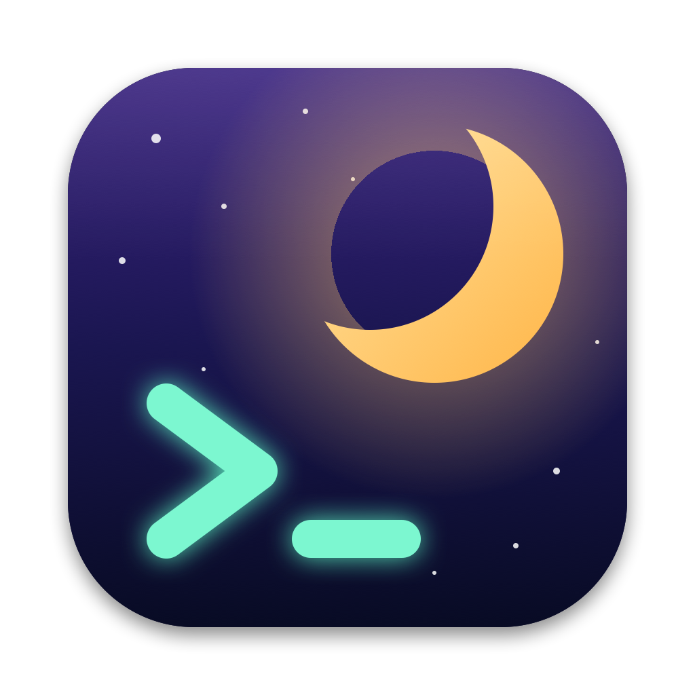
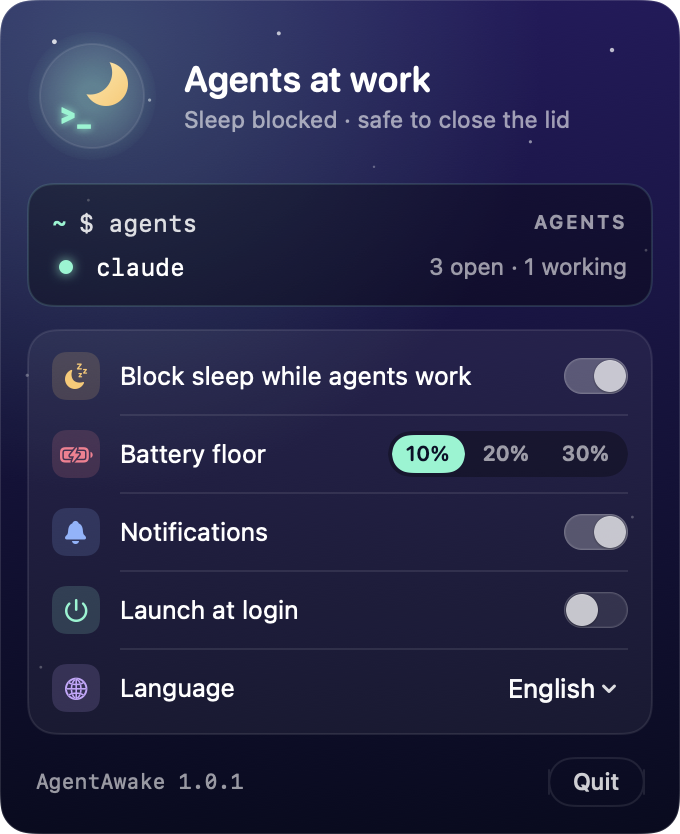
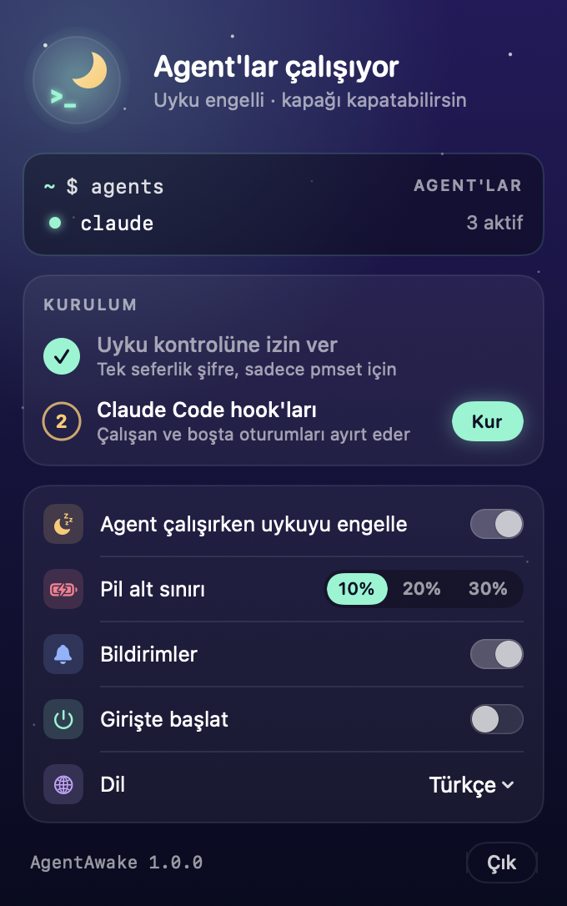
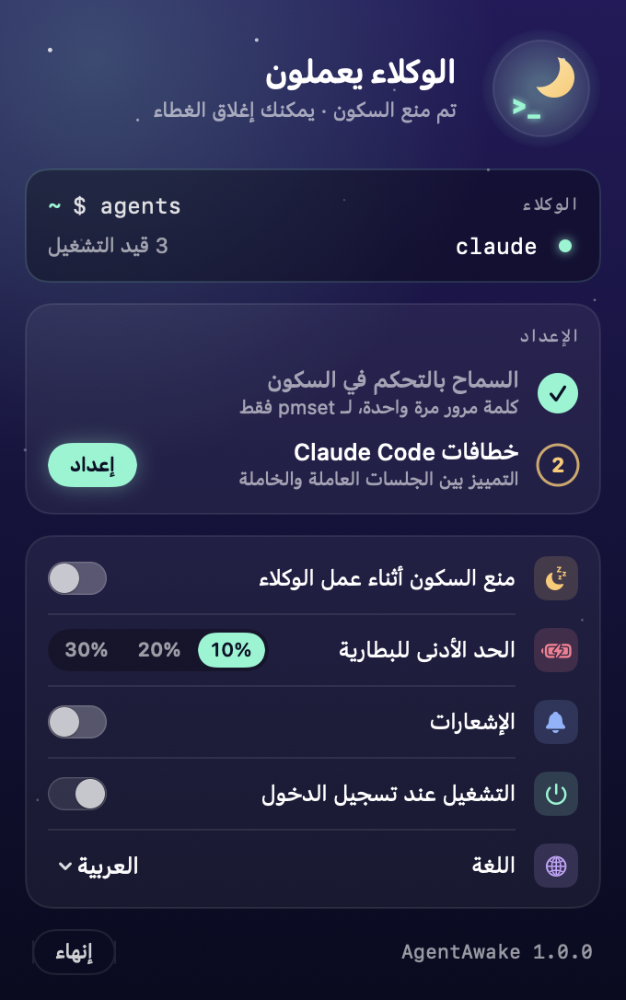

<p align="center">
  
</p>

<h1 align="center">AgentAwake</h1>

<p align="center">
  <b>Close the lid. Your agents keep working.</b><br>
  A tiny macOS menu bar app that keeps your Mac awake — even with the lid closed — <i>only</i> while an AI coding agent is actually working, and gives sleep back the moment it's done.
</p>

<p align="center">
  macOS 13+ · Apple silicon & Intel · 6 languages · MIT
</p>

<p align="center">
  
</p>

---

## The problem

You start a long Claude Code / Codex run, close your MacBook and walk away. macOS goes to sleep, the agent freezes mid-task, and you come back to nothing.

The usual fix is to remember to type this before closing the lid:

```bash
sudo pmset -a disablesleep 1
```

…and to remember to turn it back off afterwards, or your Mac never sleeps again (and cooks itself in your bag).

`caffeinate`, Amphetamine-style "keep awake" toggles and power assertions **don't help here**: they stop *idle* sleep, but closing the lid triggers sleep regardless. `disablesleep` is the only switch that covers the lid.

## What AgentAwake does

AgentAwake flips that switch for you, automatically, at the right moments:

| Situation | Sleep |
|---|---|
| A Claude Code session is working on a prompt | ❌ blocked (lid can be closed) |
| Claude Code is open but waiting for you | ✅ normal |
| `codex`, `gemini`, `aider`, `opencode` process running | ❌ blocked |
| No agents | ✅ normal |
| On battery below your floor (10 / 20 / 30 %) | ✅ normal — always wins |

### Features

- **Knows when the agent is *working*, not just open.** With the optional Claude Code hooks, an idle session that's waiting for your input doesn't keep the Mac awake. Most keep-awake tools can only check whether the process exists.
- **Lid-close safe.** Uses `pmset disablesleep`, the only mechanism that survives closing the lid.
- **Gives sleep back.** 60 s after the last agent finishes, sleep is restored, and you get a notification.
- **Never fights you.** It only reverts a setting *it* made. If you ran `pmset disablesleep 1` yourself, it leaves it alone.
- **Crash-safe.** It remembers that it owns the setting. After a crash or force-quit, the next launch restores sleep once no agents are running.
- **Battery guard.** On battery below your chosen floor (10, 20 or 30 %, default 20 %), sleep is re-enabled so a closed laptop doesn't drain to zero.
- **One password prompt, ever.** Installs a sudoers rule scoped to exactly `pmset -a disablesleep 0` and `1`. Nothing else.
- **6 languages:** English, Türkçe, 中文, हिन्दी, Español, العربية. It follows your macOS language by default and you can switch it from the menu.
- **Native and tiny.** Pure Swift/SwiftUI, no Electron, no dependencies, no network access, no telemetry.

### The panel

Click the moon in the menu bar:

- **Status orb.** It's the app icon in miniature. While agents work, a mint `>_` glows next to the moon.
- **Live agents.** A terminal-style list of running agents. Claude Code sessions show as *open* or *working* when hooks are installed.
- **Setup.** Two steps with one-click buttons, shown only until both are done.
- **Settings.** Auto-block, battery floor, notifications, launch at login and language.

The panel is fully localized, and Arabic is laid out right-to-left:

<p align="center">
  &nbsp;&nbsp;
  
</p>

| Menu bar icon | Meaning |
|---|---|
| moon | Sleep works normally |
| moon + `>_` | An agent is working, so sleep is blocked |

## Install

### Homebrew

```bash
brew tap seneralkan/tap
brew trust seneralkan/tap        # Homebrew 7+ asks you to trust third-party taps once
brew install --cask agentawake
```

The first-launch note below applies to Homebrew installs too.

### Download

Grab `AgentAwake-x.y.z.zip` from [Releases](https://github.com/seneralkan/agent-awake/releases), unzip, and drag `AgentAwake.app` to `/Applications` (or `~/Applications`).

#### "Apple could not verify AgentAwake…"

Releases are not yet signed with an Apple Developer ID or notarized. macOS therefore blocks the first launch of any app downloaded from the internet that isn't notarized. You only need to do one of the following once:

**Option A: System Settings**

1. Open `AgentAwake.app` once and dismiss the warning.
2. Go to **System Settings → Privacy & Security**, scroll down, and click **Open Anyway** next to the AgentAwake message.
3. Confirm with your password. From now on it opens normally.

**Option B: Terminal**

```bash
xattr -dr com.apple.quarantine /Applications/AgentAwake.app
```

This removes the "downloaded from the internet" flag, so the app opens without the warning.

> On macOS 15 (Sequoia) and later, the old *right-click → Open* trick no longer bypasses this warning. Use one of the options above.
>
> Building from source (below) avoids the warning entirely, because locally built apps aren't quarantined.

### Build from source

Requires the Xcode Command Line Tools (`xcode-select --install`); full Xcode is not needed.

```bash
git clone https://github.com/seneralkan/agent-awake.git
cd agent-awake
./scripts/build.sh --install     # universal build → ~/Applications/AgentAwake.app, then launches it
```

## First run (30 seconds)

Click the moon in the menu bar, then:

1. **Allow sleep control → Set up** — enter your password once. This writes `/etc/sudoers.d/agentawake`:
   ```
   <you> ALL=(root) NOPASSWD: /usr/bin/pmset -a disablesleep 0, /usr/bin/pmset -a disablesleep 1
   ```
   The rule is validated with `visudo` before it's installed. It allows those two exact commands and nothing else.
2. **Claude Code hooks → Set up** (recommended) — see below.
3. **Launch at login** — so you never have to think about it again.

## Claude Code hooks: "working" vs "open"

Without hooks, AgentAwake treats a Claude Code session as active whenever the `claude` process exists. That's safe, but it also blocks sleep while a session sits idle waiting for you.

With hooks, Claude Code tells AgentAwake when a turn starts and ends:

```
UserPromptSubmit ─▶ claude-hook.sh busy ─▶ touch  …/AgentAwake/busy/<session_id>
PreToolUse       ─▶ claude-hook.sh busy ─▶ touch  (heartbeat during long runs)
Stop             ─▶ claude-hook.sh idle ─▶ rm     …/AgentAwake/busy/<session_id>
SessionEnd       ─▶ claude-hook.sh idle ─▶ rm
```

AgentAwake polls every 5 s. If at least one fresh marker exists, Claude counts as working.

**What setting up the hooks changes:**

- Writes `~/Library/Application Support/AgentAwake/claude-hook.sh` (a ~10-line POSIX shell script; read it, it's short).
- Merges four hook entries into `~/.claude/settings.json`. Your existing settings and hooks are kept. A backup is saved first as `~/.claude/settings.json.agentawake-backup`. Note that the file is rewritten as pretty-printed JSON with sorted keys.
- Running it again is harmless; existing entries aren't duplicated.

**Safety nets:** markers are deleted when no `claude` process is running, and any marker not refreshed for 3 hours is treated as stale. A killed session can never keep your Mac awake forever.

Other agents (`codex`, `gemini`, `aider`, `opencode`) are detected by process name.

## Configuration

Everything common is in the menu. A few advanced options are set with `defaults`:

```bash
# Which process names count as agents (exact, case-sensitive match)
defaults write com.jarvis.AgentAwake processNames -array claude codex gemini aider opencode

# Reset to the default list
defaults delete com.jarvis.AgentAwake processNames
```

The match is case-sensitive on purpose: the Claude **desktop app** (`Claude`) is not counted, but Claude Code sessions it launches (`claude`) are.

## ⚠️ Things to know

- **Heat.** A Mac working with the lid closed inside a bag gets hot. Leave it on a desk, ideally plugged in.
- **Battery.** The 20 % guard re-enables sleep, but a heavy agent run can still use a lot of battery before that.
- **`disablesleep` is system-wide.** While it's on, the Mac won't sleep for *any* reason, including the Apple menu → Sleep. The display still turns off and the screen still locks.
- **Hardware differences.** Lid-closed behavior can vary slightly between Mac models and macOS versions. Test once before trusting it with an overnight run.

## Uninstall

Homebrew users: `brew uninstall --cask agentawake` does all of the steps below.

Manually:

```bash
~/Applications/AgentAwake.app/Contents/MacOS/AgentAwake --uninstall-hooks   # removes only AgentAwake's hooks
pkill -x AgentAwake
rm -rf ~/Applications/AgentAwake.app "$HOME/Library/Application Support/AgentAwake"
sudo rm /etc/sudoers.d/agentawake
sudo pmset -a disablesleep 0
defaults delete com.jarvis.AgentAwake
```

## How it compares

There are other good lid-awake apps, such as [Sleepless](https://github.com/Aboudjem/Sleepless), [StayAwake](https://github.com/TY-teo/StayAwake), [LidAwake](https://github.com/TurboKach/LidAwake), [Clolid](https://github.com/pixexid/Clolid) and [KeepingYouAwake](https://github.com/newmarcel/KeepingYouAwake) (which covers idle sleep only). AgentAwake's focus is narrower: zero-touch, agent-aware automation. You don't start or stop a session yourself. It follows what your agents are actually doing and gets out of the way.

## Development

```
Sources/AgentAwake/
  App.swift            entry point, --uninstall-hooks / --render-screenshot CLI modes
  PanelView.swift      the popover panel (theme, status orb, terminal, setup, settings)
  SleepGuard.swift     the state machine: poll → decide → pmset
  System.swift         pmset/sudo, process scanner (libproc), battery (IOKit)
  HookBridge.swift     Claude Code hook script + settings.json merge/unmerge
  Localization.swift   6 languages
  MenuBarIcon.swift    template menu bar glyph, drawn in code
  Notifier.swift       user notifications
scripts/
  build.sh             universal .app bundle (ARCHS, VERSION, SIGN_IDENTITY)
  release.sh           zip + optional notarization + SHA-256
  ship.sh              tag + push a release (CI does the rest)
  make-icon.swift      renders Resources/AppIcon.icns
packaging/homebrew/    cask template
```

Regenerate the README screenshots (renders off-screen; no screen-recording permission needed):

```bash
./build/AgentAwake.app/Contents/MacOS/AgentAwake --render-screenshot /tmp/shots   # panel-<lang>.png for every language
```

Adding a language: add a case to `Language` and a dictionary in `Localization.swift`. Missing keys fall back to English.

### Releasing

One command, from an up-to-date `main`:

```bash
./scripts/ship.sh 1.1.0
```

It checks that the tree is clean and in sync with `origin/main`, then tags `v1.1.0` and pushes the tag. The [release workflow](.github/workflows/release.yml) takes it from there:

1. It builds a universal binary and publishes the GitHub release with the zip and its SHA-256.
2. If the Apple Developer ID secrets are configured, it signs, notarizes and staples the app.
3. It bumps `version` and `sha256` in [seneralkan/homebrew-tap](https://github.com/seneralkan/homebrew-tap), using a write deploy key scoped to that repo only (`HOMEBREW_TAP_DEPLOY_KEY` secret).

All secrets are listed at the top of the workflow file.

Local build of a release zip, without publishing:

```bash
VERSION=1.1.0 SIGN_IDENTITY="Developer ID Application: …" NOTARY_PROFILE=agentawake ./scripts/release.sh
```

## License

[MIT](LICENSE)
